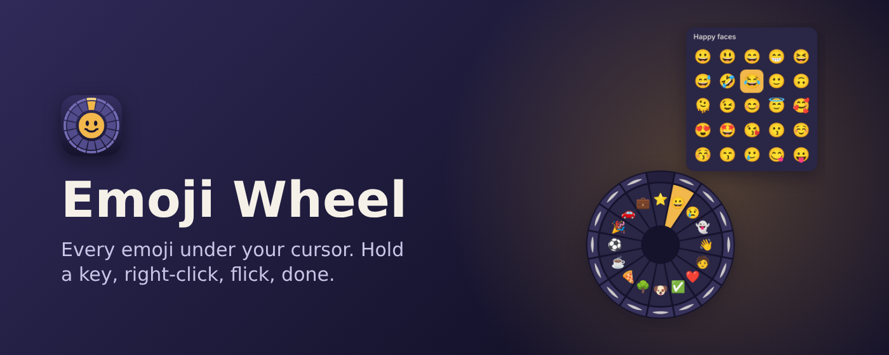
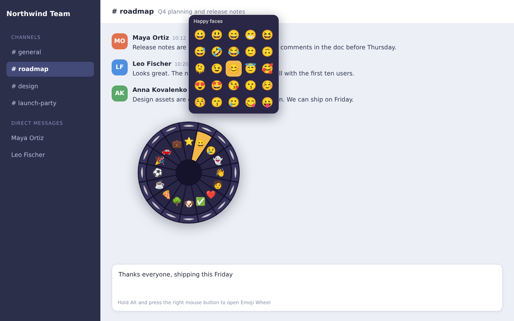
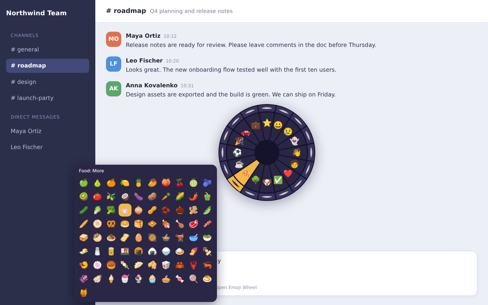
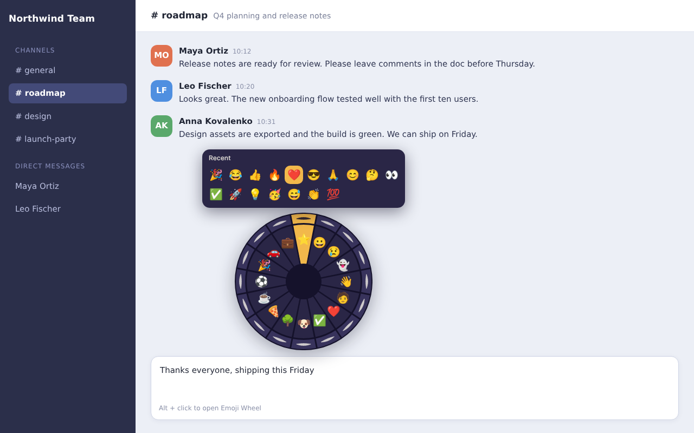
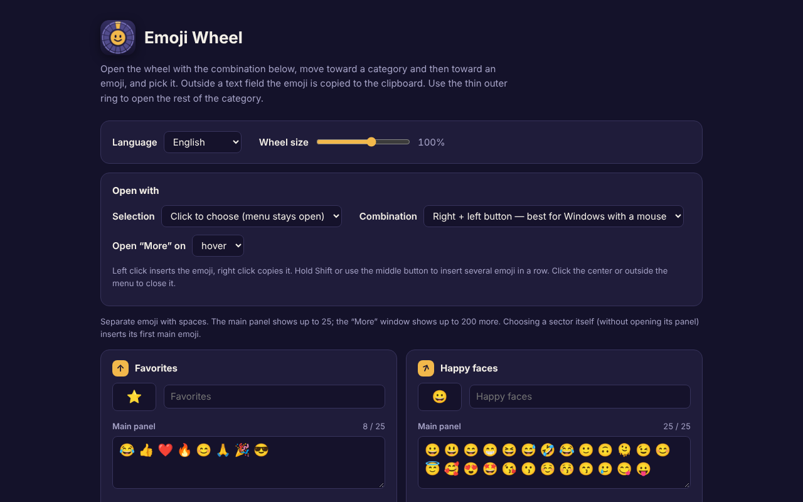

# Emoji Wheel

**English** · [Русский](#русский) · [Українська](#українська)

---

## English

Radial emoji picker: hold a key, press the right mouse button, and drop any emoji into the field you're typing in.

Emoji Wheel puts every emoji under your cursor. Hold a key, press the right mouse button, and a radial menu appears right where you are. Move toward a category, then toward an emoji, and release — it is inserted into the text field you are typing in.

## Screenshots

## How it works

- Hold **Alt** (or Shift / Ctrl) and press the right mouse button, or hold the right button and click the left one.
- Move toward one of 16 sectors: your favorites at the top and 15 themed categories, from happy faces, feelings, gestures and people to animals, food, sports, travel and objects.
- Move on to an emoji in the 5×5 panel and release. Release inside the ring to insert the category's first emoji instantly.
- Rest the cursor on the thin outer ring to open the rest of the category, up to 200 more emoji. The outer ring above Favorites shows your 25 most recently used emoji.
- Outside a text field the emoji is copied to the clipboard instead.

## Features

- A favorites sector that you fill yourself
- A large built-in emoji library, including recent Unicode releases
- Fully editable categories: names, icons and emoji lists
- Adjustable wheel size
- 14 interface languages: English, Русский, Українська, Español, Français, Deutsch, Português, Italiano, Türkçe, 中文, 日本語, 한국어, हिन्दी, العربية
- Dark settings page, export and import of settings
- Works in text fields, text areas and rich editors

## Privacy

Emoji Wheel does not collect, transmit or sell any data. It does not read page content and contains no analytics or ads. Settings are stored in Chrome (and synced through your Google account if Chrome sync is on); recently used emoji stay on your device.

## Good to know

- Chrome does not allow extensions on `chrome://` pages, the Chrome Web Store and the built-in PDF viewer, so the menu cannot open there.
- How emoji look depends on your operating system; the newest ones may appear as a box on older systems.
- On macOS and Linux the "right button + left click" option can show the system context menu; use the key option there.

## Privacy Policy

[Privacy Policy](privacy-policy.html)

---

## Русский

**Краткое описание**

Круговое меню эмодзи: зажмите клавишу, нажмите правую кнопку мыши и вставьте любой эмодзи в поле, где печатаете.

**Описание**

Emoji Wheel держит все эмодзи под рукой. Зажмите клавишу, нажмите правую кнопку мыши, и прямо под курсором появится круговое меню. Ведите курсор к категории, затем к эмодзи и отпустите кнопку: эмодзи вставится в поле, в котором вы печатаете.

#### Как это работает

- Зажмите **Alt** (или Shift / Ctrl) и нажмите правую кнопку мыши. Либо держите правую кнопку и щёлкните левой.
- Ведите курсор к одному из 16 секторов: сверху ваше избранное и 15 тематических категорий, от улыбок, эмоций, жестов и людей до животных, еды, спорта, транспорта и предметов.
- Затем двигайтесь к эмодзи в панели 5×5 и отпускайте кнопку. Если отпустить внутри кольца, сразу вставится первое эмодзи категории.
- Задержите курсор на тонком внешнем кольце, чтобы открыть остальные эмодзи категории, до 200 штук. Внешнее кольцо над избранным показывает 25 последних использованных эмодзи.
- Вне поля ввода эмодзи копируется в буфер обмена.

#### Возможности

- Сектор избранного, который вы наполняете сами
- Большая встроенная библиотека эмодзи, включая недавние версии Unicode
- Категории можно менять полностью: названия, значки, списки эмодзи
- Регулируемый размер колеса
- 14 языков интерфейса: English, Русский, Українська, Español, Français, Deutsch, Português, Italiano, Türkçe, 中文, 日本語, 한국어, हिन्दी, العربية
- Тёмная страница настроек, экспорт и импорт настроек
- Работает в полях ввода, текстовых областях и визуальных редакторах

#### Конфиденциальность

Emoji Wheel не собирает, не передаёт и не продаёт никакие данные. Расширение не читает содержимое страниц, в нём нет аналитики и рекламы. Настройки хранятся в Chrome (и синхронизируются через аккаунт Google, если включена синхронизация), а недавние эмодзи остаются только на вашем устройстве.

#### Стоит знать

- Chrome не разрешает расширениям работать на страницах `chrome://`, в Chrome Web Store и во встроенном просмотрщике PDF, поэтому там меню не откроется.
- Внешний вид эмодзи зависит от вашей операционной системы; самые новые на старых системах могут показываться квадратиком.
- На macOS и Linux вариант «правая кнопка + левый щелчок» может показывать системное контекстное меню, там лучше использовать вариант с клавишей.

---

## Українська

**Короткий опис**

Кругове меню емодзі: затисніть клавішу, натисніть праву кнопку миші та вставте будь-який емодзі в поле, де друкуєте.

**Опис**

Emoji Wheel тримає всі емодзі під рукою. Затисніть клавішу, натисніть праву кнопку миші, і просто під курсором з'явиться кругове меню. Ведіть курсор до категорії, потім до емодзі та відпустіть кнопку: емодзі вставиться в поле, у якому ви друкуєте.

#### Як це працює

- Затисніть **Alt** (або Shift / Ctrl) і натисніть праву кнопку миші. Або тримайте праву кнопку та клацніть лівою.
- Ведіть курсор до одного з 16 секторів: угорі ваше обране та 15 тематичних категорій, від усмішок, емоцій, жестів і людей до тварин, їжі, спорту, транспорту та предметів.
- Далі рухайтеся до емодзі на панелі 5×5 і відпускайте кнопку. Якщо відпустити всередині кільця, одразу вставиться перше емодзі категорії.
- Затримайте курсор на тонкому зовнішньому кільці, щоб відкрити решту емодзі категорії, до 200 штук. Зовнішнє кільце над обраним показує 25 останніх використаних емодзі.
- Поза полем введення емодзі копіюється в буфер обміну.

#### Можливості

- Сектор обраного, який ви наповнюєте самі
- Велика вбудована бібліотека емодзі, зокрема нещодавні версії Unicode
- Категорії можна змінювати повністю: назви, значки, списки емодзі
- Регульований розмір колеса
- 14 мов інтерфейсу: English, Русский, Українська, Español, Français, Deutsch, Português, Italiano, Türkçe, 中文, 日本語, 한국어, हिन्दी, العربية
- Темна сторінка налаштувань, експорт та імпорт налаштувань
- Працює в полях введення, текстових областях і візуальних редакторах

#### Конфіденційність

Emoji Wheel не збирає, не передає і не продає жодних даних. Розширення не читає вміст сторінок, у ньому немає аналітики та реклами. Налаштування зберігаються в Chrome (і синхронізуються через обліковий запис Google, якщо ввімкнена синхронізація), а нещодавні емодзі залишаються лише на вашому пристрої.

#### Варто знати

- Chrome не дозволяє розширенням працювати на сторінках `chrome://`, у Chrome Web Store та у вбудованому переглядачі PDF, тому там меню не відкриється.
- Вигляд емодзі залежить від вашої операційної системи; найновіші на старих системах можуть показуватися квадратиком.
- На macOS і Linux варіант «права кнопка + лівий клік» може показувати системне контекстне меню, там краще використовувати варіант із клавішею.
