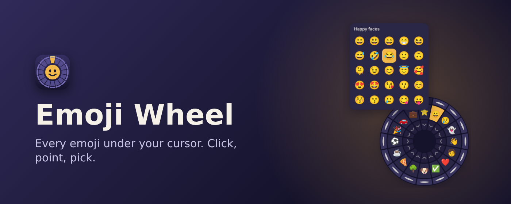
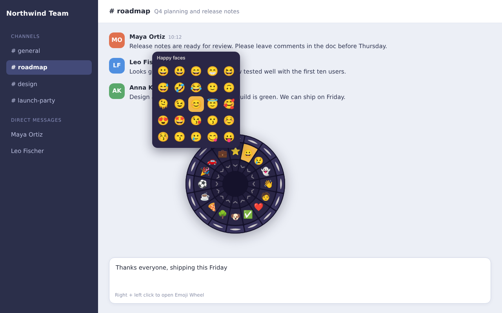
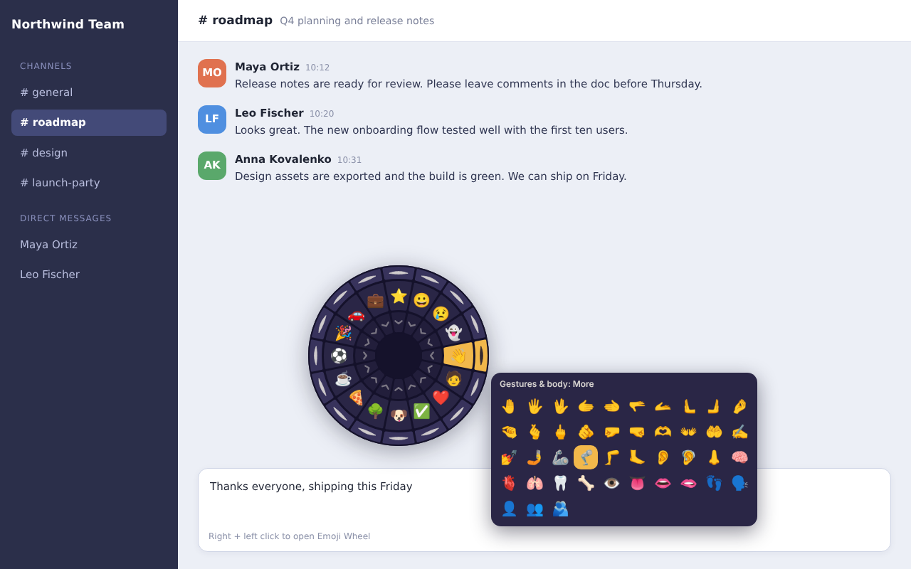
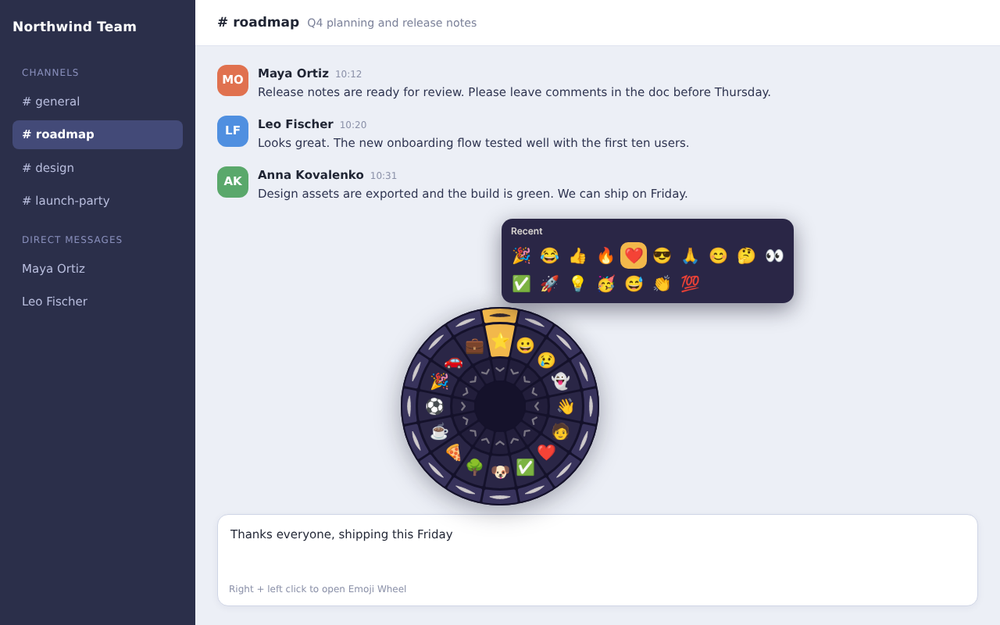
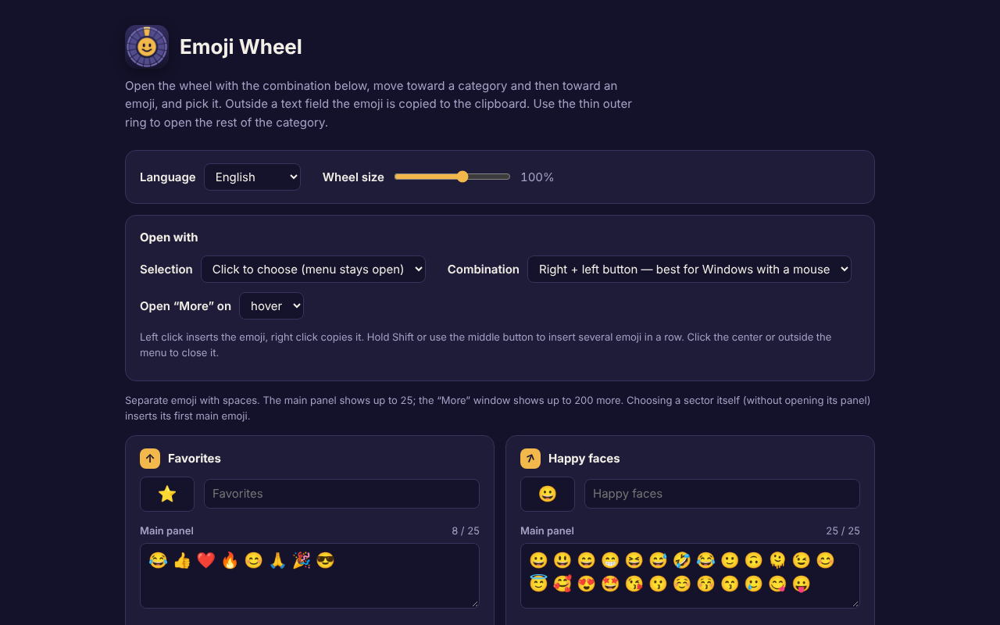

  

  

  <b>English</b> · <a href="README.ru.md">Русский</a> · <a href="README.uk.md">Українська</a>

    <a href="docs/privacy-policy.html">Privacy policy</a>
  &nbsp;·&nbsp;
  <a href="CHANGELOG.md">Changelog</a>

# Emoji Wheel

Every emoji under your cursor. Emoji Wheel is a Chrome extension that opens a radial menu right where you are: move toward a category, then toward an emoji, and click to insert it into the text field you are typing in.

## Features

- **16 sectors:** Favorites at the top plus 15 themed categories (happy faces, feelings, creatures, gestures, people & clothing, hearts & love, signs, animals, plants & weather, food, drinks, sports, party & music, travel & places, objects & work)
- **5×5 panel** for every category and a thin **outer ring** that opens up to 200 more emoji, on hover or on click (your choice)
- **Recent emoji:** the outer ring above Favorites shows your last 25
- **Left click inserts, right click copies.** Hold Shift or use the middle button to insert several emoji in a row
- **Open it your way:** presets for Windows, Linux/macOS and laptops, or your own combination of keys and mouse buttons. Choose between "click to choose" and "release to choose"
- Fully editable categories (names, icons, emoji lists), adjustable wheel size, dark settings page
- 14 interface languages, settings export and import
- Recent Unicode emoji included
- No data collection, no analytics, no remote code

## How to use

1. Open the wheel with your combination (by default **right + left button** on Windows, **Shift + right button** on Linux and macOS).
2. Move toward a sector. Its 5×5 panel opens.
3. Click an emoji: left click inserts it, right click copies it. Hold **Shift** or use the **middle button** to insert several emoji in a row.
4. Click the center, click outside the menu or press **Esc** to close it.

Hover the thin outer ring (or click it, depending on your setting) to see the rest of the category. Outside a text field the emoji is copied to the clipboard instead.

### Opening combinations

| Combination | Best for |
| --- | --- |
| Right + left button | Windows with a mouse |
| Shift + right button | Linux and macOS |
| Alt + left button | Laptops and touchpads |
| Custom | Any key or mouse button pairing |

You can also switch to **Release to choose** mode: hold a button, move, release.

## Settings

Click the extension icon to open the settings page.

## Install

- **Chrome Web Store:** [add the extension](https://chromewebstore.google.com/) *(link will be added after publication)*
- **From source:**
  1. Download or clone this repository.
  2. Open `chrome://extensions` and turn on **Developer mode**.
  3. Click **Load unpacked** and select the folder that contains `manifest.json`.

## Good to know

- Chrome does not allow extensions on `chrome://` pages, the Chrome Web Store and the built-in PDF viewer, so the menu cannot open there.
- How emoji look depends on your operating system. The newest ones may appear as a box on older systems.
- On macOS and Linux, combinations that start with the right button show the system context menu at once. Use Shift + right button there.
- If you use a mouse-gesture extension or app, pick a combination it does not react to, or build your own in the settings.

## Privacy

Emoji Wheel does not collect, transmit or sell any data and does not read page content. Settings are stored in Chrome (and synced through your Google account if Chrome sync is on); recently used emoji stay on your device. Details in the [privacy policy](docs/privacy-policy.html).

## Development

Plain JavaScript (Manifest V3), no build step.

| File | Purpose |
| --- | --- |
| `content.js` | The wheel, panels and insertion logic |
| `options.html`, `options.js` | Settings page |
| `defaults.js` | Emoji lists and the settings model |
| `i18n.js` | Translations (14 languages) |
| `_locales/` | Store name and description |

## License

Add a `LICENSE` file to choose the terms of use.
