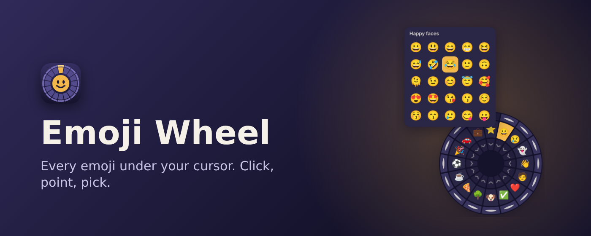
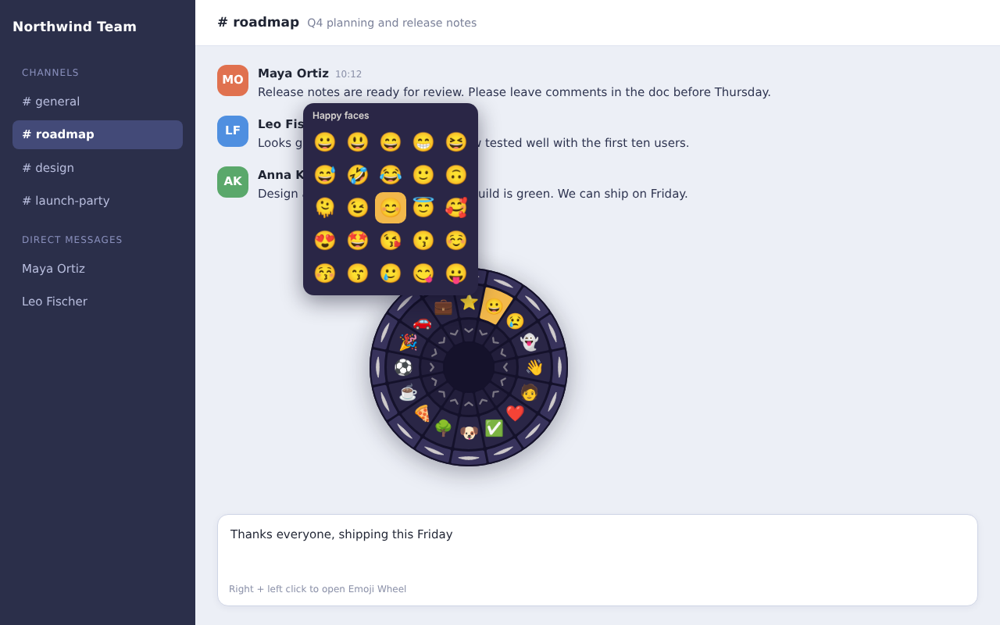
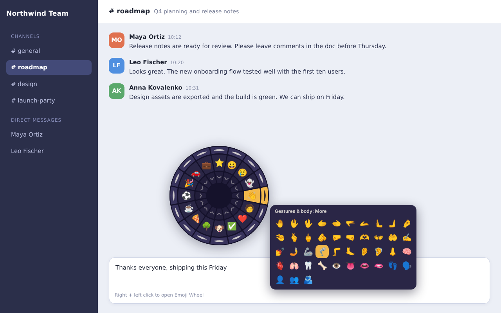
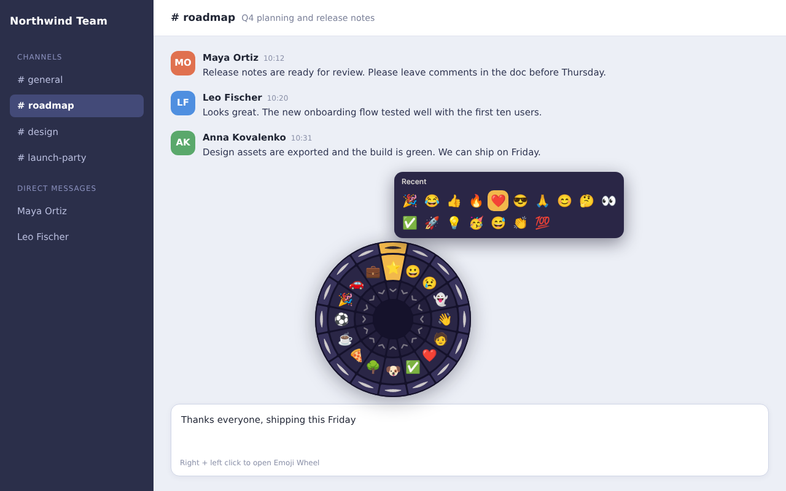
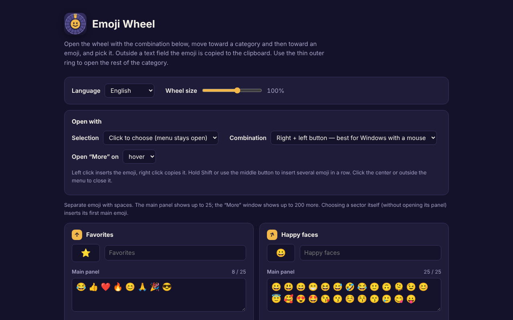

  

  

  <a href="README.md">English</a> · <b>Русский</b> · <a href="README.uk.md">Українська</a>

  <a href="docs/privacy-policy.html">Политика конфиденциальности</a>
  &nbsp;·&nbsp;
  <a href="CHANGELOG.md">Список изменений</a>

# Emoji Wheel

Любой эмодзи под курсором. Emoji Wheel — расширение для Chrome, которое открывает круговое меню прямо там, где вы работаете: наведите мышь на категорию, затем на эмодзи и кликните, чтобы вставить его в поле, где вы печатаете.

## Возможности

- **16 секторов:** сверху «Избранное» и 15 тематических категорий (улыбки, чувства, существа, жесты, люди и одежда, сердца и любовь, символы, животные, растения и погода, еда, напитки, спорт, праздник и музыка, путешествия и места, предметы и работа)
- **Панель 5×5** для каждой категории и тонкое **внешнее кольцо**, которое открывает ещё до 200 эмодзи — по наведению или по клику (на выбор)
- **Недавние эмодзи:** внешнее кольцо над «Избранным» показывает последние 25
- **Левый клик вставляет, правый копирует.** Shift или средняя кнопка — вставка нескольких эмодзи подряд
- **Открывайте как удобно:** готовые варианты для Windows, Linux/macOS и ноутбуков или собственное сочетание клавиш и кнопок мыши. Режимы «клик для выбора» и «отпустить для выбора»
- Редактируемые категории (названия, значки, списки эмодзи), настраиваемый размер колеса, тёмная страница настроек
- 14 языков интерфейса, экспорт и импорт настроек
- Эмодзи из последних версий Unicode
- Без сбора данных, без аналитики, без удалённого кода

## Как пользоваться

1. Откройте колесо своим сочетанием (по умолчанию **правая + левая кнопка** в Windows, **Shift + правая кнопка** в Linux и macOS).
2. Наведите мышь на сектор — откроется панель 5×5.
3. Кликните по эмодзи: левый клик вставляет, правый копирует. Удерживайте **Shift** или используйте **среднюю кнопку**, чтобы вставить несколько эмодзи подряд.
4. Чтобы закрыть меню, кликните по центру или вне меню либо нажмите **Esc**.

Наведите курсор на тонкое внешнее кольцо (или кликните по нему — зависит от настройки), чтобы увидеть остальные эмодзи категории. Вне текстового поля эмодзи копируется в буфер обмена.

### Сочетания для открытия

| Сочетание | Для кого |
| --- | --- |
| Правая + левая кнопка | Windows с мышью |
| Shift + правая кнопка | Linux и macOS |
| Alt + левая кнопка | Ноутбуки и тачпады |
| Своё | Любая комбинация клавиш и кнопок мыши |

Также можно включить режим **«Отпустить для выбора»**: зажмите кнопку, наведите на эмодзи, отпустите.

## Настройки

Нажмите на значок расширения, чтобы открыть страницу настроек.

## Установка

- **Chrome Web Store:** [добавить расширение](https://chromewebstore.google.com/) *(ссылка появится после публикации)*
- **Из исходников:**
  1. Скачайте или клонируйте этот репозиторий.
  2. Откройте `chrome://extensions` и включите **Режим разработчика**.
  3. Нажмите **Загрузить распакованное расширение** и выберите папку с `manifest.json`.

## Полезно знать

- Chrome не разрешает расширениям работать на страницах `chrome://`, в Chrome Web Store и во встроенном просмотрщике PDF — там меню не откроется.
- Внешний вид эмодзи зависит от операционной системы. Самые новые на старых системах могут отображаться квадратиками.
- В macOS и Linux сочетания, начинающиеся с правой кнопки, сразу показывают системное контекстное меню. Используйте там Shift + правая кнопка.
- Если вы пользуетесь расширением или программой для жестов мыши, выберите сочетание, на которое они не реагируют, или создайте своё в настройках.

## Конфиденциальность

Emoji Wheel не собирает, не передаёт и не продаёт данные и не читает содержимое страниц. Настройки хранятся в Chrome (и синхронизируются через аккаунт Google, если включена синхронизация Chrome), недавние эмодзи остаются на вашем устройстве. Подробнее — в [политике конфиденциальности](docs/privacy-policy.html).

## Разработка

Обычный JavaScript (Manifest V3), без сборки.

| Файл | Назначение |
| --- | --- |
| `content.js` | Колесо, панели и логика вставки |
| `options.html`, `options.js` | Страница настроек |
| `defaults.js` | Списки эмодзи и модель настроек |
| `i18n.js` | Переводы (14 языков) |
| `_locales/` | Название и описание для магазина |

## Лицензия

Добавьте файл `LICENSE`, чтобы определить условия использования.
