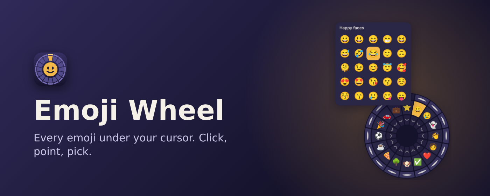
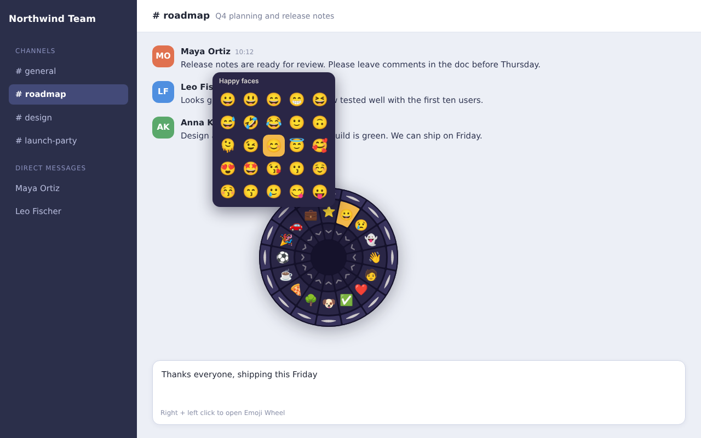
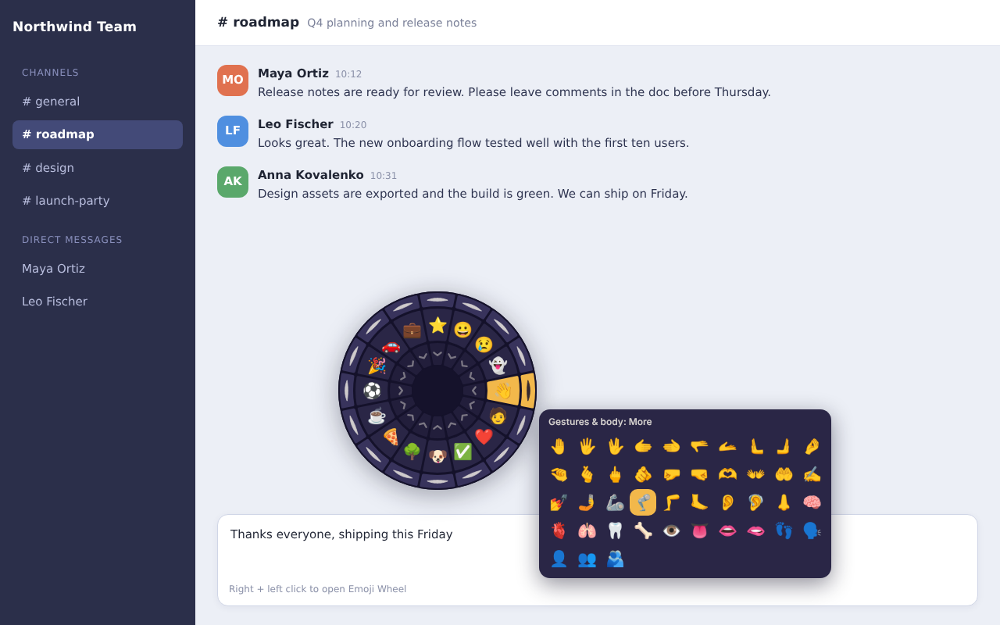
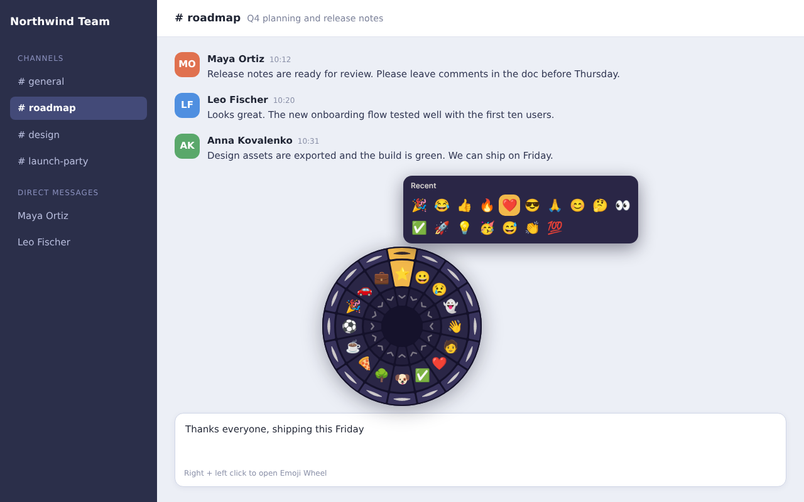
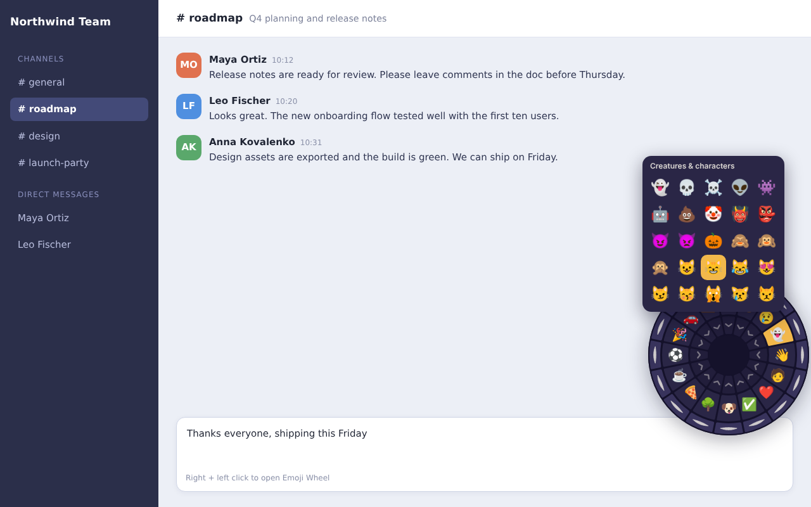
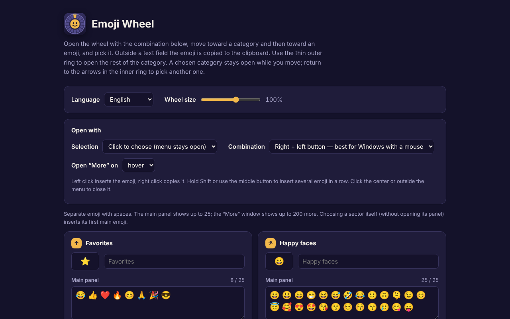

  

  <a href="README.md">English</a> · <a href="README.ru.md">Русский</a> · <b>Українська</b>

  <a href="https://chromewebstore.google.com/"><b>Встановити з Chrome Web Store</b></a>
  &nbsp;·&nbsp;
  <a href="docs/privacy-policy.html">Політика конфіденційності</a>
  &nbsp;·&nbsp;
  <a href="CHANGELOG.md">Список змін</a>

# Emoji Wheel

Будь-який емодзі під курсором. Emoji Wheel — розширення для Chrome, яке відкриває кругове меню просто там, де ви працюєте: наведіть мишу на категорію, потім на емодзі й клацніть, щоб вставити його в поле, де ви друкуєте.

## Можливості

- **16 секторів:** угорі «Обране» та 15 тематичних категорій (усмішки, почуття, істоти, жести, люди й одяг, серця та кохання, символи, тварини, рослини й погода, їжа, напої, спорт, свято й музика, подорожі та місця, предмети й робота)
- **Вікно відкривається просто поруч з категорією**, на яку ви навели, і не закриває ні шлях назад, ні кнопку «Ще». Обрана категорія лишається відкритою, поки ви ведете курсор, навіть поверх інших категорій, тож випадково вона не перемкнеться
- **Панель 5×5** для кожної категорії та тонке **зовнішнє кільце**, що відкриває ще до 200 емодзі — за наведенням або за клацанням (на вибір)
- **Нещодавні емодзі:** зовнішнє кільце над «Обраним» показує останні 25
- **Лівий клік вставляє, правий копіює.** Shift або середня кнопка — вставка кількох емодзі поспіль
- **Відкривайте як зручно:** готові варіанти для Windows, Linux/macOS і ноутбуків або власне поєднання клавіш і кнопок миші. Режими «клік для вибору» та «відпустити для вибору»
- Категорії, які можна редагувати (назви, значки, списки емодзі), регульований розмір колеса, м'який заокруглений дизайн, звичайна стрілка курсора під час вибору, темна сторінка налаштувань
- 14 мов інтерфейсу, експорт та імпорт налаштувань
- Емодзі з останніх версій Unicode
- Без збору даних, без аналітики, без віддаленого коду

## Як користуватися

1. Відкрийте колесо своїм поєднанням (за замовчуванням **права + ліва кнопка** у Windows, **Shift + права кнопка** у Linux і macOS).
2. Наведіть мишу на значок категорії — поруч із ним відкриється вікно 5×5. Категорія лишається обраною, поки ви ведете курсор; щоб обрати іншу, поверніться до маленьких стрілок у внутрішньому кільці.
3. Клацніть по емодзі: лівий клік вставляє, правий копіює. Утримуйте **Shift** або використайте **середню кнопку**, щоб вставити кілька емодзі поспіль.
4. Щоб закрити меню, клацніть по центру чи поза меню або натисніть **Esc**.

Наведіть курсор на тонке зовнішнє кільце (або клацніть по ньому — залежно від налаштування), щоб побачити решту емодзі категорії. Поза текстовим полем емодзі копіюється до буфера обміну.

### Поєднання для відкриття

| Поєднання | Для кого |
| --- | --- |
| Права + ліва кнопка | Windows з мишею |
| Shift + права кнопка | Linux і macOS |
| Alt + ліва кнопка | Ноутбуки й тачпади |
| Власне | Будь-яка комбінація клавіш і кнопок миші |

Також можна ввімкнути режим **«Відпустити для вибору»**: утримайте кнопку, наведіть на емодзі, відпустіть.

## Налаштування

Натисніть на значок розширення, щоб відкрити сторінку налаштувань.

## Встановлення

- **Chrome Web Store:** [додати розширення](https://chromewebstore.google.com/) *(посилання з'явиться після публікації)*
- **З вихідного коду:**
  1. Завантажте або клонуйте цей репозиторій.
  2. Відкрийте `chrome://extensions` і ввімкніть **Режим розробника**.
  3. Натисніть **Завантажити нерозпаковане розширення** та виберіть теку з `manifest.json`.

## Корисно знати

- Chrome не дозволяє розширенням працювати на сторінках `chrome://`, у Chrome Web Store та у вбудованому переглядачі PDF — там меню не відкриється.
- Вигляд емодзі залежить від операційної системи. Найновіші на старих системах можуть відображатися квадратиками.
- У macOS і Linux поєднання, що починаються з правої кнопки, одразу показують системне контекстне меню. Користуйтеся там Shift + права кнопка.
- Якщо ви користуєтеся розширенням чи програмою для жестів миші, оберіть поєднання, на яке вони не реагують, або створіть власне в налаштуваннях.

## Конфіденційність

Emoji Wheel не збирає, не передає й не продає дані та не читає вміст сторінок. Налаштування зберігаються в Chrome (і синхронізуються через обліковий запис Google, якщо ввімкнено синхронізацію Chrome), нещодавні емодзі залишаються на вашому пристрої. Докладніше — у [політиці конфіденційності](docs/privacy-policy.html).

## Розробка

Звичайний JavaScript (Manifest V3), без збирання.

| Файл | Призначення |
| --- | --- |
| `content.js` | Колесо, панелі та логіка вставки |
| `options.html`, `options.js` | Сторінка налаштувань |
| `defaults.js` | Списки емодзі та модель налаштувань |
| `i18n.js` | Переклади (14 мов) |
| `_locales/` | Назва й опис для магазину |

## Ліцензія

Додайте файл `LICENSE`, щоб визначити умови використання.
